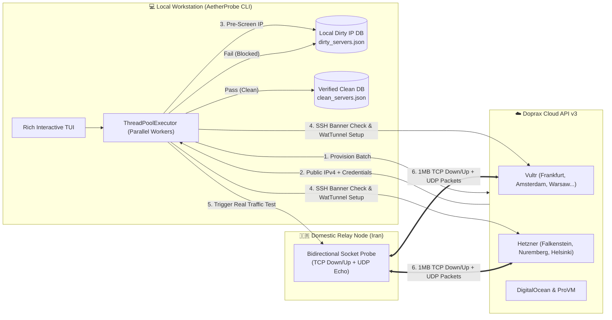

<div align="center">

# ⚡ AetherProbe — Doprax Clean IP Hunter

**High-Concurrency Cloud IP Discovery, WatTunnel Provisioning & Bidirectional TCP/UDP Benchmarking Suite**

[](https://github.com/AdamBarfii/doprax-clean-ip-hunter/releases)
[](https://www.python.org/)
[](https://www.doprax.com/)
[](LICENSE)

<p align="center">
  <a href="#-overview">Overview</a> •
  <a href="#-architecture--workflow">Architecture</a> •
  <a href="#-supported-cloud-providers">Providers</a> •
  <a href="#-quick-start">Quick Start</a> •
  <a href="#-terminal-preview">Preview</a> •
  <a href="#-راهنمای-جامع-فارسی">🇮🇷 راهنمای فارسی</a>
</p>

</div>

---

## 🌐 Overview

**AetherProbe (`doprax-clean-ip-hunter`)** is a production-grade CLI orchestration engine that automates the discovery of unblocked, routeable ("Clean") IPv4 addresses across global cloud datacenters (**Vultr**, **Hetzner**, **DigitalOcean**, and **ProVM**) using a single **Doprax Cloud API key**.

Instead of relying on superficial ICMP pings—which frequently pass through firewalls while actual tunnel traffic is throttled or dropped—**AetherProbe** spins up cloud instances in parallel, deploys **[WatTunnel](https://github.com/JohnWatsoon/WatTunnel)** on the foreign node (*Kharej*), and executes a real-time **bidirectional TCP & UDP throughput and packet-loss benchmark** directly from your domestic relay server (*Iran*).

---

## 🏗️ Architecture & Workflow



### 🔬 4-Stage Verification Pipeline
1. **Local Dirty IP Pre-Screening (`O(1)` Lookup)**: Checks the newly assigned IPv4 against your local `dirty_servers.json` registry. If a cloud provider recycles a previously blocked IP, AetherProbe flags it immediately (`PRE-FLAGGED DIRTY`) before wasting time on installation.
2. **Cloud-Init & OpenSSH Banner Readiness**: Probes TCP port `22` until the remote `sshd` daemon transmits a valid `SSH-2.0-...` identification banner and completes `cloud-init` root password activation.
3. **Unattended WatTunnel Deployment**: Connects to the foreign VM, installs `wattun-manager`, configures the tunnel in unattended *Kharej* mode, and extracts the `wat1:...` connection token.
4. **Dual-Socket Iran-to-Kharej Benchmark (with Auto-Retry)**:
   - **GFW Routeability Check**: Verifies TCP port `22` reachability directly from the Iran server.
   - **TCP Download & Upload**: Transfers 1 MB of random payload in both directions (`Kharej -> Iran` and `Iran -> Kharej`) and calculates throughput in `KB/s`.
   - **UDP Echo & Packet Loss**: Transmits burst UDP datagrams and verifies echo round-trips (`<= 40%` loss threshold).
   - **Zero False Positives**: Any failed probe automatically waits 2 seconds and executes a second verification pass before marking an IP as dirty.

---

## ☁️ Supported Cloud Providers

All providers below are provisioned through your **single Doprax account balance**—no external Vultr or Hetzner accounts required:

| Provider | Code | Top Locations | Cheapest Plan | Starting Price |
| :--- | :--- | :--- | :--- | :--- |
| **Vultr** | `vultr` | 🇩🇪 Frankfurt, 🇳🇱 Amsterdam, 🇵🇱 Warsaw, 🇫🇷 Paris, 🇬🇧 London, 🇯🇵 Tokyo | `VC2-1C-1GB` (1 vCPU / 1GB) | **`$8.04 / mo`** |
| **Hetzner** | `hetzner` | 🇩🇪 Falkenstein, 🇩🇪 Nuremberg, 🇫🇮 Helsinki, 🇸🇬 Singapore | `CX23 (EU)` (2 vCPU / 4GB) | **`~$5.50 / mo`** |
| **ProVM** | `provm` | 🇵🇱 Poland, 🇬🇧 United Kingdom | `P1` | **`~$4.95 / mo`** |
| **DigitalOcean** | `digitalocean` | 🇩🇪 Frankfurt, 🇳🇱 Amsterdam, 🇬🇧 London, 🇺🇸 New York | `Basic 1GB` | **`~$7.00 / mo`** |

---

## 🖥️ Terminal Preview

```text
██████╗  ██████╗ ██████╗ ██████╗  █████╗ ██╗  ██╗
██╔══██╗██╔═══██╗██╔══██╗██╔══██╗██╔══██╗╚██╗██╔╝
██║  ██║██║   ██║██████╔╝██████╔╝███████║ ╚███╔╝ 
██║  ██║██║   ██║██╔═══╝ ██╔══██╗██╔══██║ ██╔██╗ 
██████╔╝╚██████╔╝██║     ██║  ██║██║  ██║██╔╝ ██╗
╚═════╝  ╚═════╝ ╚═╝     ╚═╝  ╚═╝╚═╝  ╚═╝╚═╝  ╚═╝
   🚀 Doprax Clean IP Hunter (Vultr · ProVM · Hetzner · DO) 🚀
     Multithreaded Parallel Benchmarking | Local Dirty IP Storage

┏━━━━┳━━━━━━━━━━━━━━━━━┳━━━━━━━━━━━━━━━━━┳━━━━━━━┳━━━━━━━━━━━━━━━━┳━━━━━━━━━━━━━━━━┓
┃  # ┃ Location Name   ┃ Datacenter Code ┃ Plans ┃ Starting Price ┃ Cheapest Plan  ┃
┡━━━━╇━━━━━━━━━━━━━━━━━╇━━━━━━━━━━━━━━━━━╇━━━━━━━╇━━━━━━━━━━━━━━━━╇━━━━━━━━━━━━━━━━┩
│  1 │ DE, Frankfurt   │ vultr_fra       │  30   │ $8.04/mo       │ VC2-1C-1GB     │
│  2 │ NL, Amsterdam   │ vultr_ams       │  26   │ $8.04/mo       │ VC2-1C-1GB     │
│  3 │ PL, Warsaw      │ vultr_waw       │  26   │ $8.04/mo       │ VC2-1C-1GB     │
│  4 │ FR, Paris       │ vultr_cdg       │  26   │ $8.04/mo       │ VC2-1C-1GB     │
│  5 │ GB, London      │ vultr_lhr       │  29   │ $8.04/mo       │ VC2-1C-1GB     │
└────┴─────────────────┴─────────────────┴───────┴────────────────┴────────────────┘

┏━━━┳━━━━━━━━━━━━━━━━━┳━━━━━━━━━━━━━━┳━━━━━━━━━━━━━━━━━━━━┳━━━━━━━━━━━━━━━━━┳━━━━━━━━━━━━━━┓
┃ # ┃ Public IP       ┃ Datacenter   ┃ TCP Test           ┃ UDP Test        ┃ Result       ┃
┡━━━╇━━━━━━━━━━━━━━━━━╇━━━━━━━━━━━━━━╇━━━━━━━━━━━━━━━━━━━━╇━━━━━━━━━━━━━━━━━╇━━━━━━━━━━━━━━┩
│ 1 │ 140.233.177.122 │ Doprax/VULTR │ ✗ ↓0.0K ↑0.0K      │ ✗ Loss: 100.0%  │ DIRTY (مسدود)│
│ 2 │ 95.179.241.88   │ Doprax/VULTR │ ✓ ↓4820.5K ↑3910K  │ ✓ Loss: 0.0%    │ CLEAN (تمیز) │
│ 3 │ 45.76.89.14     │ Doprax/VULTR │ Pre-Flagged Dirty  │ Seen 2026-10-24 │ FLAGGED DIRTY│
└───┴─────────────────┴──────────────┴────────────────────┴─────────────────┴──────────────┘
```

---

## 🚀 Quick Start

### 1. Clone & Install Dependencies
```bash
git clone https://github.com/AdamBarfii/doprax-clean-ip-hunter.git
cd doprax-clean-ip-hunter
pip install -r requirements.txt
```

### 2. Configure Credentials
Copy the example configuration file and add your Doprax API Key and Iran server SSH details (or configure them interactively via Menu Option `[6]`):
```bash
cp config.example.json config.json
```

```json
{
  "doprax_api_key": "YOUR_DOPRAX_API_KEY_HERE",
  "iran_server": {
    "host": "YOUR_IRAN_SERVER_IP",
    "port": 22,
    "username": "root",
    "password": "YOUR_IRAN_SSH_PASSWORD",
    "key_path": ""
  },
  "defaults": {
    "batch_size": 3,
    "provider": "vultr",
    "plan": "VC2-1C-1GB",
    "location": "DE, Frankfurt",
    "os": "ubuntu_24_04",
    "carrier": "auto"
  }
}
```

### 3. Launch AetherProbe
- **Windows**: Double-click [`start.bat`](start.bat) or run:
  ```powershell
  python doprax_hunter.py
  ```
- **Linux / macOS**:
  ```bash
  python3 doprax_hunter.py
  ```

---

## 📂 Repository Structure

| File | Description |
| :--- | :--- |
| [`doprax_hunter.py`](doprax_hunter.py) | Main Rich TUI orchestrator, multithreaded worker pool, location/plan selector, and lifecycle manager. |
| [`doprax_client.py`](doprax_client.py) | Production Doprax API v1/v2/v3 SDK with HTTP retry pooling, 10s cooldown handling, and status polling. |
| [`ssh_manager.py`](ssh_manager.py) | OpenSSH banner readiness verifier, unattended WatTunnel installer, and dual-socket TCP/UDP probe engine. |
| [`dirty_manager.py`](dirty_manager.py) | Thread-safe, atomic JSON/TXT registry for blocked IPs with hit counter and unflag support. |
| [`DOPRAX_API_REFERENCE.md`](DOPRAX_API_REFERENCE.md) | Comprehensive engineering reference manual for all 26 Doprax Cloud API endpoints. |
| [`complete_operations.json`](complete_operations.json) | Machine-readable OpenAPI/JSON schema of Doprax API operations and payloads. |
| [`config.example.json`](config.example.json) | Sanitized configuration template. |
| [`custom_servers.example.txt`](custom_servers.example.txt) | Template for batch-testing third-party external VPS instances. |

---
---

<div dir="rtl">

## 🇮🇷 راهنمای جامع فارسی

**سامانه هوشمند AetherProbe (شکارچی آی‌پی تمیز دوپراکس)** یک ابزار خط فرمان (CLI) پیشرفته، چندرشته‌ای (Multithreaded) و آماده بهره‌برداری (Production-Ready) برای پیدا کردن خودکار آی‌پی‌های تمیز و فیلترنشده در دیتاسنترهای جهانی (**Vultr**، **Hetzner**، **DigitalOcean** و **ProVM**) از طریق پنل ابری **Doprax** است.

### ✨ چرا AetherProbe؟
بسیاری از اسکریپت‌های معمولی فقط پینگ (ICMP) یا باز بودن پورت را تست می‌کنند؛ در حالی که روی بسیاری از آی‌پی‌ها پینگ باز است اما ترافیک تانل یا پکت‌های UDP مسدود هستند. این برنامه:
1. **چندین سرور را به صورت هم‌زمان (موازی)** در دیتاسنتر دلخواه شما (مثلاً آلمانِ والتر یا هتزنر) می‌سازد.
2. صبر می‌کند تا `cloud-init` و بنر واقعی سرویس `OpenSSH` کاملاً آماده شوند.
3. اسکریپت **WatTunnel** را به صورت خودکار روی سرور خارج نصب و توکن آن را استخراج می‌کند.
4. به سرور ایران شما وصل شده و **ترافیک واقعی ۱ مگابایت دانلود و آپلود TCP و پکت‌های اکو UDP** را بین سرور ایران و سرور خارج تبادل و بنچمارک می‌کند.
5. **دیتابیس محلی آی‌پی‌های مسدود (`dirty_servers.json`):** هر آی‌پی که مسدود باشد را در کامپیوتر شما ذخیره می‌کند تا اگر دیتاسنتر دوباره همان آی‌پی را به شما داد، بلافاصله بدون اتلاف وقت آن را با برچسب `PRE-FLAGGED DIRTY` شناسایی کند.
6. **کنترل کامل حذف و جلوگیری از کسر شارژ اضافی:** پس از اتمام تست، هیچ سروری را سرخود پاک نمی‌کند؛ بلکه از شما می‌پرسد که آیا فقط سرورهای کثیف پاک شوند، سرور خاصی پاک شود یا همه سرورها نگه داشته شوند.

---

### 🛠️ امکانات منوی اصلی

- **`[1]` Start Clean IP Hunter:** ساخت و تست هم‌زمان سرورهای جدید در **Vultr** (فرانکفورت آلمان، آمستردام هلند، ورشو لهستان، پاریس، لندن، توکیو و...)، **Hetzner** (فالکن‌اشتاین و نورنبرگ آلمان، فنلاند)، **ProVM** و **DigitalOcean**.
  - *نکته:* قابلیت جستجوی متنی لوکیشن فعال است؛ کافیست تایپ کنید `germany`، `fra`، `de` یا `ams` تا لوکیشن و ارزان‌ترین پلن آن به صورت خودکار انتخاب شوند.
- **`[2]` Test Existing Running Doprax VMs:** تست هم‌زمان سرورهایی که از قبل در اکانت دوپراکس خود روشن دارید.
- **`[3]` Test Custom External Server(s):** تست و بنچمارک سرورهای شخصی خارج از دوپراکس (تکی یا از طریق فایل `custom_servers.txt`).
- **`[4]` View Dirty IPs Database:** مشاهده جدول کامل آی‌پی‌های مسدود ثبت‌شده به همراه تعداد دفعات برخورد (`Hits`)، علت مسدودی و امکان خارج کردن آی‌پی از لیست سیاه (Unflag).
- **`[5]` Check Doprax Balance & Quotas:** مشاهده موجودی دلاری اکانت دوپراکس و تعداد سرورهای مجاز.
- **`[6]` Configure API Key & Iran Server SSH:** تنظیم کلید API دوپراکس و مشخصات SSH سرور ایران.
- **`[7]` List & Manage Doprax VMs:** مشاهده و حذف دستی سرورهای فعال در اکانت دوپراکس.
- **`[8]` View Saved Clean Servers:** مشاهده لیست سرورهای تمیز پیدا شده، پسورد روت، سرعت دانلود/آپلود و توکن WatTunnel آن‌ها (ذخیره شده در `clean_servers.txt`).

---

### ⚡ نحوه نصب و اجرا در ویندوز

۱. ابتدا پیش‌نیازها را نصب کنید:
```powershell
pip install -r requirements.txt
```

۲. روی فایل **`start.bat`** دابل‌کلیک کنید (یا دستور `python doprax_hunter.py` را اجرا نمایید).

۳. در اولین اجرا، گزینه **`[6]`** را بزنید و `API Key` دوپراکس و آی‌پی و رمز `SSH` سرور ایران خود را وارد کنید. سپس با گزینه **`[1]`** شکار آی‌پی تمیز را آغاز کنید!

</div>

---

## 📄 License

Distributed under the **MIT License**. See [`LICENSE`](LICENSE) for more information.
